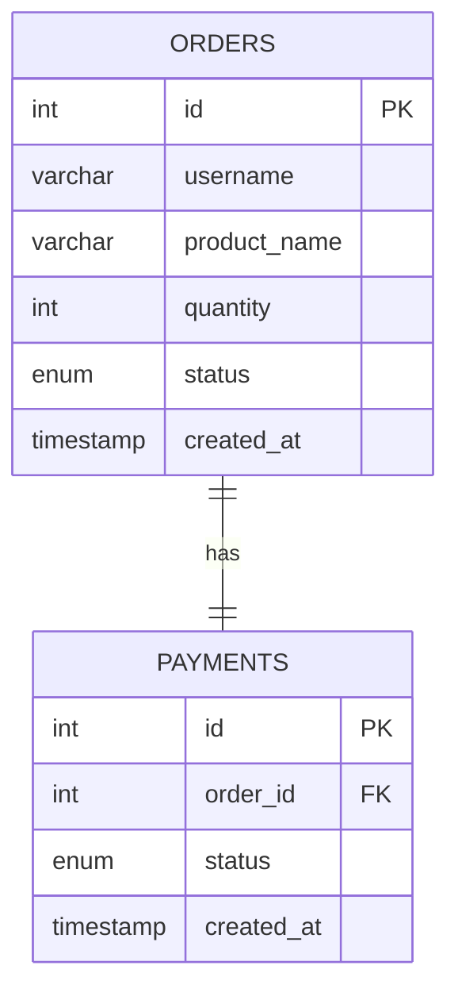
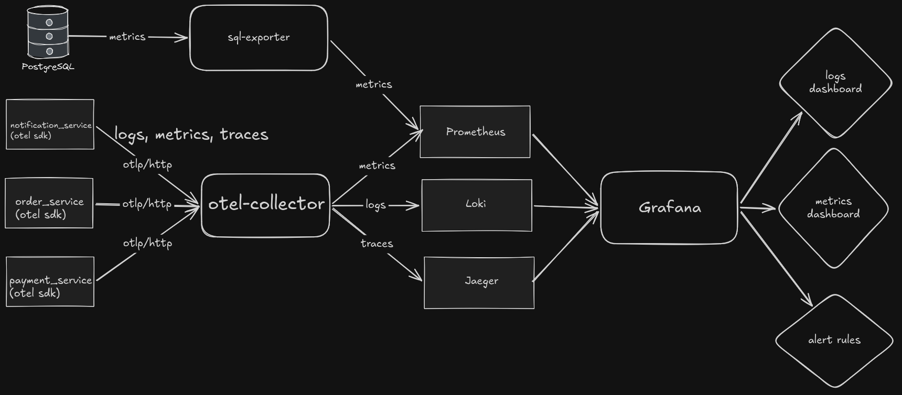

# Microservices devops

## Кратко о проекте

Данный проект является учебным в сфере Backend/DevOps. В рамках проекта были написаны три простеньких микросервиса при помощи Python (FastAPI). Взаимодействие между микросервисами было настроено при помощи Kafka. Помимо 3 микросервисов и Kafka, в разработке была задействована СУБД PostgreSQL. В качестве единой точки входа в приложение используется nginx.

В качестве стека Observability были выбраны следующие инструменты: Otel-collector для сбора логов, метрик и трейсов по протоколу OTLP, sql-exporter для экспорта метрик с PostgreSQL, Prometheus для хранения и доступа к метрикам, Loki для хранения и доступа к логам, Jaeger для визуализации трейсов и, наконец, Grafana для единого доступа к логам, метрикам и трейсам и для алертинга.

Все сервисы запускаются в контейнерах. Для создания образов контейнеров был выбран Docker, а для локальной оркестрации Docker Compose. В будущем планируется задеплоить все это в Kubernetes с использованием Helm.

## Архитектура микросервисов


## Таблицы в БД

С таблицей orders взаимодействует только order_service, а с таблицей payments -- только payment_service



## Observability



По-хорошему, в будущем лучше добавить внутрь коллектора хотя бы какой-нибудь batch, ну а пока так

## Деплой в Docker Compose

```bash
docker compose up -d
```

По идее, достаточно одной команды, однако для полноценного деплоя требуется установить следующие переменные окружения или добавить их в .env:

- POSTGRES_USER
- POSTGRES_PASSWORD
- POSTGRES_DB
- GF_SECURITY_ADMIN_USER
- GF_SECURITY_ADMIN_PASSWORD

Однако, если хотите в графане настроить алертинг через Telegram contact point, то нужен тг бот и соотвественно TG_BOT_API_TOKEN в качестве переменной окружения. Более того понадобится доступ к api.telegram.org, то есть придется прокидывать проксю в контейнер с графаной, что по умолчанию делается для моей системы. Можете убрать или закоментировать данные строчки из компоуза сервиса `grafana`, если не планируете обращаться к тг:

```yaml
HTTP_PROXY: http://172.21.0.1:12334
HTTPS_PROXY: http://172.21.0.1:12334
NO_PROXY: localhost,127.0.0.1,loki,prometheus,jaeger
```

## Деплой в Kubernetes

Скоро
